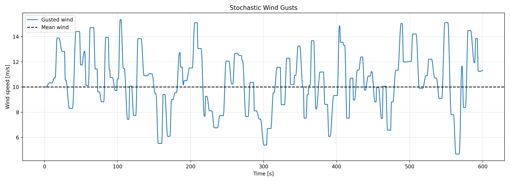
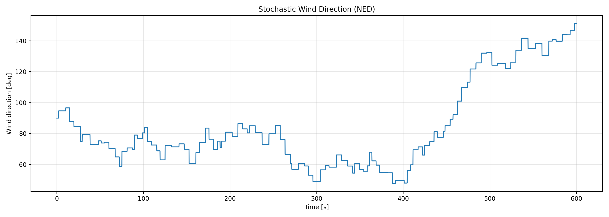
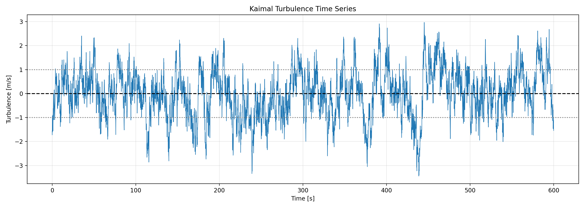
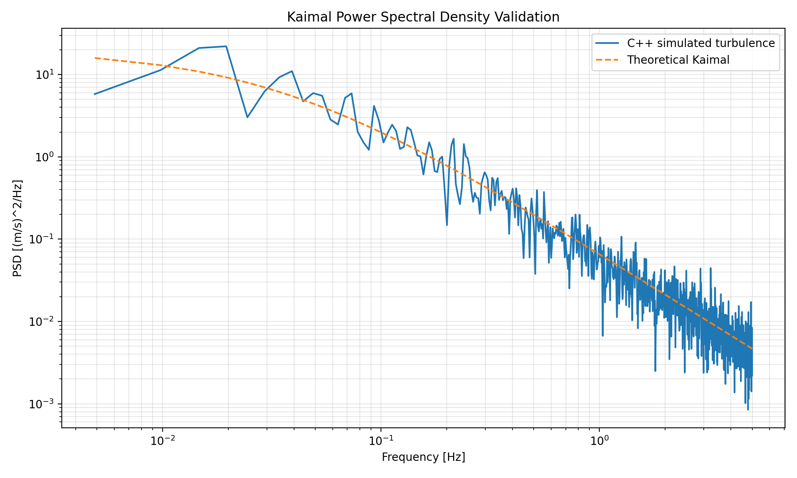
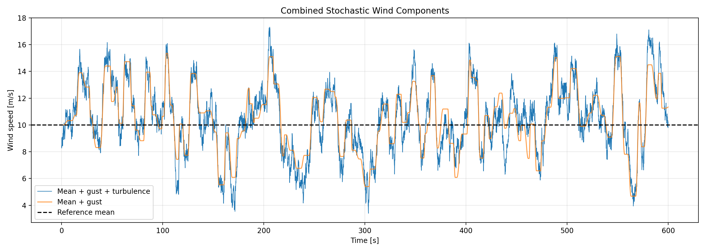
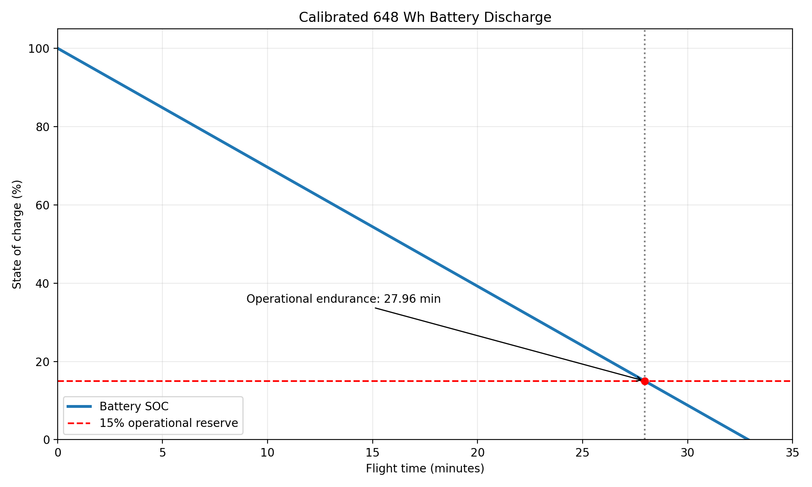

# Cosys-AirSim

Cosys-AirSim is a simulator for drones, cars and more, with extensive API support, built on [Unreal Engine](https://www.unrealengine.com/). It is open-source, cross platform, and supports hardware-in-loop with popular flight controllers such as PX4 for physically and visually realistic simulations. It is developed as an Unreal plugin that can simply be dropped into any Unreal environment. 

This fork is based on last public AirSim release from Microsoft's GitHub.
Cosys-Lab made extensive modifications to the AirSim platform to support multiple projects and research goals. 
Please contact a Cosys-Lab researcher to get more in depth information on our work or if you wish to collaborate. 
The [original AirSim MIT license](https://github.com/Cosys-Lab/Cosys-AirSim/blob/main/LICENSE) applies to all native AirSim source files. 
Please note that we use that same [MIT license](https://github.com/Cosys-Lab/Cosys-AirSim/blob/main/LICENSE) as which applies to all changes made by Cosys-Lab in case you plan to do anything within this repository.
Do note that this repository is provided as is, will not be actively updated and comes without warranty or support. 
Please contact a Cosys-Lab researcher to get more in depth information on which branch or version is best for your work.

This [main branch](https://github.com/Cosys-Lab/Cosys-AirSim/tree/main) is for the latest supported Unreal Version v5.8, maintained for support, and is available for builds in the [releases](https://github.com/Cosys-Lab/Cosys-AirSim/releases).
Unreal [5.2.1](https://github.com/Cosys-Lab/Cosys-AirSim/tree/5.2.1) is also available for long term support.

## Associated publications

- [Cosys-AirSim: A Real-Time Simulation Framework Expanded for Complex Industrial Applications](https://arxiv.org/abs/2303.13381)
```
@inproceedings{cosysairsim2023jansen,
  author={Jansen, Wouter and Verreycken, Erik and Schenck, Anthony and Blanquart, Jean-Edouard and Verhulst, Connor and Huebel, Nico and Steckel, Jan},
  booktitle={2023 Annual Modeling and Simulation Conference (ANNSIM)}, 
  title={COSYS-AIRSIM: A Real-Time Simulation Framework Expanded for Complex Industrial Applications}, 
  year={2023},
  doi={https://doi.org/10.48550/arXiv.2303.13381}}
```

You can also find the presentation of the live tutorial of Cosys-AirSim at ANNSIM '23 conference [here](https://github.com/Cosys-Lab/Cosys-AirSim/tree/main/docs/annsim23_tutorial) together with the associated videos.


- [Physical LiDAR Simulation in Real-Time Engine](https://arxiv.org/abs/2208.10295)
```
@inproceedings{lidarsim2022jansen,
  author={Jansen, Wouter and Huebel, Nico and Steckel, Jan},
  booktitle={2022 IEEE Sensors}, 
  title={Physical LiDAR Simulation in Real-Time Engine}, 
  year={2022},
  pages={1-4},
  doi={10.1109/SENSORS52175.2022.9967197}}
}
```
- [Simulation of Pulse-Echo Radar for Vehicle Control and SLAM](https://www.mdpi.com/1424-8220/21/2/523)
```
@Article{echosim2021schouten,
  author={Schouten, Girmi and Jansen, Wouter and Steckel, Jan},
  title={Simulation of Pulse-Echo Radar for Vehicle Control and SLAM},
  JOURNAL={Sensors},
  volume={21},
  year={2021},
  number={2},
  article-number={523},
  doi={10.3390/s21020523}
}
```

## Cosys-Lab Modifications
* Updated for Unreal 5.
* Added [multi-layer annotation](https://cosys-lab.github.io/Cosys-AirSim/annotation) for groundtruth label generation with RGB, greyscale and texture options. Extensive API integration and available for camera and GPU-LiDAR sensors.
* Added [Instance Segmentation](https://cosys-lab.github.io/Cosys-AirSim/instance_segmentation). 
* Added [Echo sensor type](https://cosys-lab.github.io/Cosys-AirSim/echo) for simulation of sensors like sonar and radar.
* Added [GPU LIDAR sensor type](https://cosys-lab.github.io/Cosys-AirSim/gpulidar): Uses GPU acceleration to simulate a LiDAR sensor. Can support much higher point density then normal LiDAR and behaves more authentic and has realistic intensity generation.
* Added [skid steering SimMode and vehicle type](https://cosys-lab.github.io/Cosys-AirSim/skid_steer_vehicle). ClearPath Husky and Pioneer P3DX implemented as vehicle types using this new vehicle model. 
* Added [Matlab API Client](https://cosys-lab.github.io/Cosys-AirSim/matlab) implementation as an easy to install Matlab toolbox.
* Added various [random but deterministic dynamic object types and world configuration options](https://cosys-lab.github.io/Cosys-AirSim/dynamic_objects).
* Added [Artificial Lights](https://cosys-lab.github.io/Cosys-AirSim/lights). 
* Added BoxCar vehicle model to the Car SimMode to have a smaller vehicle to use in indoor spaces.
* Added a new image type called [Lighting](https://cosys-lab.github.io/Cosys-AirSim/image_apis) which only shows the light information and no materials.
* Updated [ComputerVision mode](https://cosys-lab.github.io/Cosys-AirSim/image_apis#computer-vision-mode-1): Now has full API and Simulation just like other vehicle types. It mostly means it can now have sensors attached (outside of IMU). Improved handling and camera operation.
* Updated [LIDAR sensor type](https://cosys-lab.github.io/Cosys-AirSim/lidar): Fixed not tracing correctly, added ground truth (point labels) generation, added range-noise generation. Improved API pointcloud delivery to be full scan instead of being frame-rate dependent and partial.
* Updated the camera, Echo and (GPU-)LiDAR sensors to be uncoupled from the vehicle and be placed as external world sensors.
* Updated sensors like cameras, Echo sensor and GPU-LiDAR to ignore certain objects with the _MarkedIgnore_ Unreal tag and enabling the "IgnoreMarked" setting in [the settings file](https://cosys-lab.github.io/Cosys-AirSim/settings).
* Updated cameras sensor with more distortion features such as chromatic aberration, motion blur and lens distortion. 
* Updated Python [ROS implementation](https://cosys-lab.github.io/Cosys-AirSim/ros_python) with completely new implementation and feature set.
* Updated C++ [ROS2 implementation](https://cosys-lab.github.io/Cosys-AirSim/ros2) to support custom Cosys-AirSim features.
* Dropped support for Unity Environments.

Some more details on our changes can be found in the [changelog](https://github.com/Cosys-Lab/Cosys-AirSim/blob/main/CHANGELOG.md).

## How to Get It
#### Download and run from packaged binary - Windows/Linux
* [Download and run it](https://cosys-lab.github.io/Cosys-AirSim/run_packaged)
#### Download and install from precompiled plugin - Windows/Linux
* [Download and install it](https://cosys-lab.github.io/Cosys-AirSim/install_precompiled)
#### Install and use from source - Windows
* [Install/Build it](https://cosys-lab.github.io/Cosys-AirSim/install_windows)
#### Install and use from source - Linux
* [Install/Build it](https://cosys-lab.github.io/Cosys-AirSim/install_linux)

## How to Use It

### Documentation

View our [detailed documentation](https://cosys-lab.github.io/Cosys-AirSim/) on all aspects of Cosys-AirSim.

## Original AirSim Paper

More technical details are available in [AirSim paper (FSR 2017 Conference)](https://arxiv.org/abs/1705.05065). Please cite this as:
```
@inproceedings{airsim2017fsr,
  author = {Shital Shah and Debadeepta Dey and Chris Lovett and Ashish Kapoor},
  title = {AirSim: High-Fidelity Visual and Physical Simulation for Autonomous Vehicles},
  year = {2017},
  booktitle = {Field and Service Robotics},
  eprint = {arXiv:1705.05065},
  url = {https://arxiv.org/abs/1705.05065}
}
```

## License

This project is released under the MIT License. Please review the [License file](https://github.com/Cosys-Lab/Cosys-AirSim/blob/main/LICENSE) for more details.

<!-- AIRSIDE_WTG_API_START -->

## AirSide runtime APIs

AirSide extends the Python client with simulator TimeOfDay control and
wind-turbine runtime APIs.

### Connect

```python
import cosysairsim

client = cosysairsim.MultirotorClient()
client.confirmConnection()
```

### Simulator TimeOfDay

TimeOfDay uses Unix epoch time in 100-nanosecond ticks.

There are `10,000,000` ticks per second.

Set the simulator time:

```python
from datetime import datetime, timezone

dt = datetime(2026, 10, 19, 13, 30, tzinfo=timezone.utc)
ticks = int(dt.timestamp() * 10_000_000)

client.simSetTimeOfDay(
    True,
    ticks,
    celestial_clock_speed=1,
    update_interval_secs=60,
    move_sun=True
)
```

Read the current simulator time:

```python
ticks = client.simGetTimeOfDay()

if ticks:
    dt = datetime.fromtimestamp(
        ticks / 10_000_000,
        tz=timezone.utc
    )
    print(dt)
```

Disable TimeOfDay:

```python
client.simSetTimeOfDay(False)
```

`simGetTimeOfDay()` returns `0` when TimeOfDay is disabled.

> Note: simulator API timestamps are Unix/UTC based. Unreal's on-screen
> clock may display local time depending on the host configuration.

### Wind turbine IDs

The Offshore Wind Farm map exposes 36 turbines:

```text
WTG_01 ... WTG_36
```

### Schedule turbine downtime

```python
ok = client.simSetTurbineDowntime(
    "WTG_04",
    "2026-10-20 13:30",
    "2026-10-23 09:00"
)

print(ok)
```

Datetime format:

```text
YYYY-MM-DD HH:MM
```

Downtime semantics are:

```text
start <= simulator_time < end
```

The turbine stops at the start time and resumes exactly at the end time.

Same-day, overnight, and multi-day downtime intervals are supported.

Downtime scheduling uses the simulator TimeOfDay clock. In the current
implementation, the supplied calendar values correspond to UTC/Unix
simulator time; Unreal's displayed clock may appear in local time.

### Read turbine orientations

```python
orientations = client.simGetTurbineOrientations("WTG_04")

for name, value in orientations.items():
    print(name, value)
```

The returned dictionary includes orientation values for turbine
components such as:

```text
actor
tower
nacelle
rotor
hub
ring
blade_1
blade_2
blade_3
```

Both local and world orientations are available.

Orientation vectors use:

```text
[roll, pitch, yaw]
```

with values expressed in degrees.

Euler-angle representations can wrap or flip while describing the same
physical orientation, so component-wise Euler differences should not be
used as the only test for physical rotation.

<!-- AIRSIDE_WTG_API_END -->

## Vessel motion API

AirSide exposes runtime vessel control through the Python RPC client. Vessel latitude, longitude, altitude, and velocity are reported from the center of the vessel charging pad / helideck.

`simSetVesselTarget(latitude, longitude, speed_mps)` commands a geographic target and desired horizontal speed. It returns `True` when the target and route are accepted.

`simGetVesselState()` returns the current vessel position, velocity, speed, heading, target, distance to target, route state, and arrival state.

Example: move the vessel 100 m north at 3 m/s:

```python
import math
import time
import cosysairsim

client = cosysairsim.MultirotorClient()
client.confirmConnection()

state = client.simGetVesselState()

if state.get("valid") != 1.0:
    raise RuntimeError("Vessel is not available")

target_latitude = state["latitude"] + math.degrees(
    100.0 / 6378137.0
)
target_longitude = state["longitude"]

accepted = client.simSetVesselTarget(
    target_latitude,
    target_longitude,
    3.0
)

if not accepted:
    raise RuntimeError("Vessel target was rejected")

while True:
    state = client.simGetVesselState()

    print(
        f"speed={state['speed_mps']:.2f} m/s "
        f"north={state['velocity_north_mps']:.2f} m/s "
        f"east={state['velocity_east_mps']:.2f} m/s "
        f"remaining={state['distance_to_target_m']:.1f} m "
        f"arrived={state['arrived']:.0f}"
    )

    if state["arrived"] == 1.0:
        break

    time.sleep(1.0)
```

The vessel charging pad is the authoritative GNSS reference point. The physical ship, charging pad, and collision plane move together.

### Docked drone vessel following

Starting with v2.2.1, an unarmed drone that is physically grounded inside the vessel helideck follows the vessel as the platform moves. Each drone is handled independently, so multiple grounded drones can remain on the moving helideck at the same time.

Vessel following requires the drone to remain grounded, unarmed, and inside a `vessel_helideck` charging-pad volume. When those conditions no longer apply, vessel-follow translation stops and normal AirSim vehicle physics remains responsible for the drone motion.

The charging state machine remains separate from vessel following and continues to use its existing docking and charging eligibility checks.

## Stochastic Wind Model

AirSide integrates a configurable stochastic wind generator and optional cylinder aerodynamic model into AirSim's `FastPhysicsEngine`. The wind generator combines reference wind, stochastic gusts, horizontal direction changes, Kaimal turbulence and altitude-dependent shear. The aerodynamic model converts relative airflow into rigid-body forces and moments. No additional FFT library is required.

### Quick start

Edit `~/Documents/AirSim/settings.json` on Linux or `%USERPROFILE%\Documents\AirSim\settings.json` on Windows. Merge the following root-level `WindModel` object into your existing JSON; do not replace vehicle, PX4, battery, camera or other settings. Restart the simulator after changing the configuration. This example enables the complete model.

```json
{
  "WindModel": {
    "Enabled": true,
    "Model": "StochasticWind",
    "UpdateRateHz": 10.0,
    "RandomSeed": 42,
    "ReferenceWind": {
      "SpeedMps": 10.0,
      "DirectionNED": {"X": 0.0, "Y": 1.0, "Z": 0.0},
      "ReferenceAltitudeM": 5.0,
      "ShearExponent": 0.14,
      "MinimumAltitudeM": 0.1
    },
    "Gust": {
      "Enabled": true,
      "TargetSpeedStdDevMps": 2.5,
      "RampDurationMinSec": 0.5,
      "RampDurationMaxSec": 5.0,
      "HoldDurationMinSec": 0.5,
      "HoldDurationMaxSec": 5.0,
      "MaxStepRateMps2": 2.0,
      "MaxDirectionChangeDeg": 10.0
    },
    "Turbulence": {
      "Enabled": true,
      "StdDevMps": 1.0,
      "LengthScaleM": 50.0,
      "SeriesDurationSec": 600.0
    },
    "Aerodynamics": {
      "Mode": "PaperCylinder",
      "AirDensityKgM3": 1.225,
      "DragCoefficient": 1.1,
      "RadiusM": 0.75,
      "HeightM": 0.30,
      "LateralAreaScale": 1.0,
      "FrontalAreaScale": 1.0,
      "VerticalDrag": false,
      "VerticalAreaM2": 1.7671458676,
      "CenterOfPressureM": {"X": 0.0, "Y": 0.0, "Z": 0.0},
      "MaximumForceN": 1000.0
    }
  }
}
```

### General settings

| Parameter | Default | Meaning |
|---|---|---|
| `Enabled` | false | Enable the stochastic wind model. |
| `Model` | StochasticWind | Model selector; use this exact string. |
| `UpdateRateHz` | 10.0 | Wind signal update frequency in Hz; use a positive value. |
| `RandomSeed` | 42 | Nonnegative seeds reproduce the sequence in the same implementation/build; negative seeds request nondeterministic initialization. |

Wind evolves in simulation time, with samples held between wind updates. Forces are evaluated at physics updates. The global wind signal is shared by vehicles, with shear evaluated at each vehicle's altitude.

### Reference wind and coordinates

| Parameter | Default | Meaning |
|---|---|---|
| `SpeedMps` | 10.0 | Reference wind speed in m/s. |
| `DirectionNED` | (0,1,0) | World-frame horizontal airflow direction. |
| `ReferenceAltitudeM` | 5.0 | Reference altitude in metres; use a positive value. |
| `ShearExponent` | 0.14 | Power-law exponent, clamped to [0,1]; zero disables shear. |
| `MinimumAltitudeM` | 0.1 | Lower altitude bound in metres. |

AirSim uses North-East-Down (NED): +X north, +Y east, +Z down. Direction indicates where air flows **towards**, not where it originates. The horizontal vector is normalized; Z is ignored. A zero horizontal vector falls back to northward airflow.

| Airflow towards | X | Y | Z |
|---|---:|---:|---:|
| North | 1 | 0 | 0 |
| East | 0 | 1 | 0 |
| South | -1 | 0 | 0 |
| West | 0 | -1 | 0 |
| Northeast | 1 | 1 | 0 |

### Stochastic gusts

| Parameter | Default | Meaning |
|---|---:|---|
| `Enabled` | true | Enable gusts and associated direction changes. |
| `TargetSpeedStdDevMps` | 2.5 | Standard deviation of target speed draws around reference speed, in m/s. |
| `RampDurationMinSec` | 0.5 | Minimum ramp duration, seconds. |
| `RampDurationMaxSec` | 5.0 | Maximum ramp duration, seconds. |
| `HoldDurationMinSec` | 0.5 | Minimum hold duration, seconds. |
| `HoldDurationMaxSec` | 5.0 | Maximum hold duration, seconds. |
| `MaxStepRateMps2` | 2.0 | Bounds target speed change divided by ramp duration, in m/s². |
| `MaxDirectionChangeDeg` | 10.0 | Maximum direction change per gust event, degrees. |

The model chooses a random target speed and ramp duration, constrains the target speed to be nonnegative and bounds its change from the previous target. It interpolates with a one-minus-cosine ramp:

```text
V(t) = Vstart + (Vtarget - Vstart) * 0.5 * (1 - cos(pi * t / Tramp))
```

Here t is time since ramp start. The target is then held for a randomly chosen duration. Use positive durations and ordered minimum/maximum values. The step-rate setting is not a strict instantaneous acceleration bound: the cosine ramp's peak slope is pi/2 times its average slope. Direction changes occur at ramp starts and accumulate as a random walk, rather than staying within a fixed angular band around the initial heading.

### Wind shear

```text
V(z) = Vref * (max(z, zmin) / zref)^alpha
```

Altitude z is minus the vehicle's world NED Z coordinate, relative to the local simulation origin, not terrain-relative height or independently calculated altitude above mean sea level. Reference altitude zref and minimum altitude zmin should be positive. The same shear multiplier applies to the combined slow and turbulent wind signal.

Example: 10 m/s reference speed at 5 m, exponent 0.14.

| Altitude (m) | Wind speed (m/s) |
|---:|---:|
| 1 | 7.983 |
| 5 | 10.000 |
| 10 | 11.019 |
| 50 | 13.804 |
| 100 | 15.211 |

### Kaimal turbulence

| Parameter | Default | Meaning |
|---|---:|---|
| `Enabled` | true | Enable longitudinal turbulence. |
| `StdDevMps` | 1.0 | Target spectral turbulence standard deviation, m/s. |
| `LengthScaleM` | 50.0 | Positive turbulence length scale, metres. |
| `SeriesDurationSec` | 600.0 | Positive requested time-series duration, seconds. |

The model uses the one-sided Kaimal power spectral density:

```text
S(f) = (4 * sigma^2 * L / U) / (1 + 6 * f * L / U)^(5/3)
```

Here sigma is turbulence intensity expressed as a velocity standard deviation, L is length scale, U is reference mean speed, and f is frequency in Hz. Gaussian Fourier coefficients with Hermitian symmetry are transformed by a standalone inverse FFT (Bluestein algorithm using radix-2 FFTs). The turbulence random stream is separate from the gust random stream. The DC component is removed.

At 10 Hz and 600 s, the generated series has 6000 samples and repeats every 600 s. The implementation rounds sample count up to an even integer (minimum eight); other settings can therefore produce a slightly different period. Requests exceeding one million samples or invalid duration/length scale are rejected by the generator. Use a positive reference wind speed for physically meaningful Kaimal parameters. Finite bandwidth and finite random realizations mean the measured standard deviation need not exactly equal the configured target.

Turbulence is longitudinal, not independent lateral or vertical turbulence. The scalar fluctuation is added before shear and is not clamped to nonnegative total speed; sufficiently strong fluctuations can reverse the instantaneous airflow.

### Combined wind

```text
Vwind(t,z) = direction(t) * [Vslow(t) + Vturbulence(t)]
             * (max(z,zmin) / zref)^alpha
```

Vslow is the reference speed as modified by gusts. Disable gusts, turbulence or shear independently to isolate their effects.

### Drone aerodynamics

`PaperCylinder` models the drone as an equivalent cylindrical envelope. The default dimensions and coefficients are initial estimates, not calibrated measurements of any particular drone.

| Parameter | Default | Meaning |
|---|---|---|
| `Mode` | PaperCylinder | Select cylinder aerodynamics; other strings fall back to AirSim vertex drag. |
| `AirDensityKgM3` | 1.225 | Air density, kg/m³. |
| `DragCoefficient` | 1.1 | Dimensionless drag coefficient. |
| `RadiusM` | 0.75 | Equivalent radius, metres (diameter 1.5 m). |
| `HeightM` | 0.30 | Equivalent cylinder height, metres. |
| `LateralAreaScale` | 1.0 | Multiplier on lateral area contribution. |
| `FrontalAreaScale` | 1.0 | Multiplier on circular area contribution. |
| `VerticalDrag` | false | Enable drag along body Z. |
| `VerticalAreaM2` | 1.7671458676 | Effective body-Z area, m²; independently configured. |
| `CenterOfPressureM` | (0,0,0) | Body-frame offset of force application point from center of gravity, metres. |
| `MaximumForceN` | 1000.0 | Maximum total force magnitude, N; nonpositive disables the clamp. |

Relative airflow is computed in world coordinates and transformed into the body frame:

```text
Vrel_world = Vvehicle_world - Vwind_world
```

Effective projected areas depend on roll and pitch:

```text
Ax = a * pi * r * h * abs(cos(pitch)) + b * pi * r^2 * abs(sin(pitch))
Ay = a * pi * r * h * abs(cos(roll))  + b * pi * r^2 * abs(sin(roll))
```

Here a and b are the lateral and frontal scale factors. These are effective model areas, not exact geometric projections of a physical cylinder. For a level vehicle the default horizontal area term is approximately 0.707 m². The default vertical area is pi*r²; update `VerticalAreaM2` separately when changing geometry if appropriate.

```text
Fx = -0.5 * rho * Cd * |Vrel| * Ax * Vrel_x
Fy = -0.5 * rho * Cd * |Vrel| * Ay * Vrel_y
Fz = -0.5 * rho * Cd * |Vrel| * Az * Vrel_z  (if enabled)
```

All these components use body-frame velocity. When vertical drag is disabled, body-Z relative velocity is set to zero before computing the norm and force. This does not imply zero world-Z force for a tilted drone. Force magnitude is clamped before computing the moment:

```text
Torque_body = CenterOfPressure_body cross Force_body
```

The force is transformed back into world coordinates; torque stays in body coordinates. Both enter the existing rigid-body equations alongside rotor forces and moments. At a zero center-of-pressure offset, there is no torque from that offset. Cylinder drag replaces the existing vertex drag, including its angular damping, rather than adding a second drag force. The standard grounded-body physics behavior remains unchanged.

### Configuration examples

Each example below is a root-level JSON fragment to merge into your existing settings. Keep unrelated settings unchanged; omitted wind fields use the model defaults when not otherwise specified. Restart the simulator between changes.

#### Constant wind (recommended first test)

```json
{"WindModel": {
  "Enabled": true, "Model": "StochasticWind",
  "ReferenceWind": {"SpeedMps": 5.0, "DirectionNED": {"X": 0, "Y": 1, "Z": 0}, "ShearExponent": 0.0},
  "Gust": {"Enabled": false},
  "Turbulence": {"Enabled": false}
}}
```

#### Gusts without turbulence or shear

```json
{"WindModel": {
  "Enabled": true, "Model": "StochasticWind",
  "ReferenceWind": {"SpeedMps": 10.0, "ShearExponent": 0.0},
  "Gust": {"Enabled": true, "TargetSpeedStdDevMps": 2.5},
  "Turbulence": {"Enabled": false}
}}
```

#### Kaimal turbulence without gusts or shear

```json
{"WindModel": {
  "Enabled": true, "Model": "StochasticWind",
  "ReferenceWind": {"SpeedMps": 10.0, "ShearExponent": 0.0},
  "Gust": {"Enabled": false},
  "Turbulence": {"Enabled": true, "StdDevMps": 1.0, "LengthScaleM": 50.0, "SeriesDurationSec": 600.0}
}}
```

#### Complete offshore wind

```json
{"WindModel": {
  "Enabled": true, "Model": "StochasticWind", "RandomSeed": 42,
  "ReferenceWind": {"SpeedMps": 10.0, "ReferenceAltitudeM": 5.0, "ShearExponent": 0.14},
  "Gust": {"Enabled": true},
  "Turbulence": {"Enabled": true, "StdDevMps": 1.0},
  "Aerodynamics": {"Mode": "PaperCylinder"}
}}
```

#### Custom aerodynamic geometry

```json
{"WindModel": {
  "Enabled": true, "Model": "StochasticWind",
  "Aerodynamics": {"Mode": "PaperCylinder", "RadiusM": 0.50, "HeightM": 0.20, "DragCoefficient": 1.0, "VerticalAreaM2": 0.785398, "VerticalDrag": false}
}}
```

These dimensions are illustrative only. Calibrate against your vehicle and available thrust before using stronger wind conditions.

#### Stochastic wind with standard AirSim drag

```json
{"WindModel": {"Enabled": true, "Model": "StochasticWind", "Aerodynamics": {"Mode": "AirSim"}}}
```

#### Disable the stochastic model and restore legacy wind

```json
{
  "WindModel": {"Enabled": false},
  "Wind": {"X": 0.0, "Y": 5.0, "Z": 0.0}
}
```

The legacy `simSetWind` API sets the standard AirSim wind vector. When the stochastic model is active, its generated wind takes precedence. Disable the model to use the legacy wind path.

### Numerical validation

The Linux Unreal Editor build succeeded with Unreal Engine 5.8.2. Standalone C++ tests of the wind generator and the extracted production aerodynamic function were run on Ubuntu. These validate selected mathematical cases, not complete closed-loop flight behavior.

| Wind test | Observed result |
|---|---|
| Reference wind | Exact (0,10,0) m/s NED |
| Shear | Agreement within floating-point precision |
| Gust speed range | 4.680–15.353 m/s |
| Turbulence sample count | 6000 |
| Turbulence mean | Approximately zero |
| Target / measured standard deviation | 1.000000 / 0.996482 m/s |
| Fixed-seed reproducibility | Zero difference |
| 600-second periodicity | Zero difference |
| Kaimal PSD | Visually consistent with theoretical spectrum |

| Relative wind (m/s) | Calculated force (N), level stationary drone |
|---:|---:|
| 0 | 0.000 |
| 5 | 11.906 |
| 10 | 47.625 |
| 15 | 107.155 |
| 20 | 190.498 |

All tested aerodynamic checks passed, including relative velocity, force sign, pitch dependence, center-of-pressure torque, vertical drag and force clamping. For example, 10 m/s wind and a 0.2 m body-Z center-of-pressure offset yielded 9.525 N·m about body Y. A 100 N clamp limited the tested 50 m/s wind case to 100 N.

### Validation plots











The combined plot is reconstructed from the separately sampled gust and turbulence signals. The PSD comparison is a visual assessment of a finite realization.

### Limitations and recommended flight validation

- Wind configuration is global; no per-vehicle aerodynamic configuration, spatially varying turbulence, turbine wakes or obstacle-induced airflow is modeled.
- Direction changes accumulate over time, and the turbulence series repeats periodically.
- Cylinder geometry, drag coefficient and center of pressure require vehicle-specific calibration. The model does not include independent aerodynamic angular damping when cylinder mode is selected.
- Start with zero wind and compare standard AirSim drag against cylinder mode. Then test constant 5 m/s wind, stronger wind as appropriate, gusts, turbulence and shear individually before combining them.
- Monitor position error, velocity, attitude, thrust saturation and battery power using your drone management system. Ensure PX4 connections and lockstep simulation are functioning.
- Integrated ROS2/PX4 flight validation remains pending. Numerical agreement does not establish flight-controller stability or physical accuracy for the real aircraft.

---

## Calibrated Battery Model

Introduced in AirSide v2.4.0, the calibrated battery model
provides dynamic propulsion energy consumption, voltage,
current, state of charge and battery charging.

The model is compatible with the existing stochastic wind,
docking, vessel-following and PX4 integration systems.

### Reference Drone and Battery

| Parameter | Value |
|---|---|
| Reference drone mass | Approximately 6 kg |
| Additional payload | None |
| Motor reference | T-Motor MN6007 V2 Antigravity |
| Battery | Perkons Energy Li-ion |
| Cell configuration | 6S6P |
| Rated capacity | 30 Ah |
| Nominal voltage | 21.6 V |
| Maximum voltage | 25.2 V |
| Rated energy capacity | 648 Wh |
| Continuous discharge rating | 240 A |
| Recommended charging current | 15 A (0.5C) |
| Estimated pack resistance | 0.013 ohm |
| Operational SOC reserve | 15% |

[Motor manufacturer reference](https://store.tmotor.com/product/mn6007-v2-motor-antigravity-type.html)

### Mathematical Model

Rotor mechanical power is calculated from rotor torque
and angular velocity.

Electrical power demand is calculated as:

$$
P_e = k_m P_m + P_a + k_c \max(0,v_c)
$$

The selected reference configuration is:

$$
P_e = 17.5187 P_m + 10
$$

The scaling coefficient maps simulated rotor mechanical
power to reference electrical demand. It is not a physical
motor efficiency.

Battery voltage is calculated using:

$$
V = V_{OCV}(SOC) - IR
$$

For feasible electrical loads, battery current is:

$$
I = \frac{V_{OCV}-\sqrt{V_{OCV}^2-4RP_e}}{2R}
$$

Remaining battery energy is integrated over simulation time:

$$
E(t)=E(0)-\frac{1}{3600}\int_0^t P_e(\tau)d\tau
$$

The energy-based state of charge is:

$$
SOC(t)=\frac{E(t)}{E_{capacity}}
$$

### Configuration

Add the following Battery object inside each relevant
vehicle definition in settings.json.

```json
"Battery": {
    "Model": "Calibrated",
    "CapacityWh": 648.0,
    "NominalVoltage": 21.6,
    "MechanicalPowerScale": 17.5187,
    "ClimbPowerCoefficient": 0.0,
    "AvionicsDrawW": 10.0,
    "InternalResistanceOhm": 0.013,
    "InitialStateOfCharge": 1.0,
    "LowStateOfChargeThreshold": 0.15,
    "Charging": {
        "Enabled": true,
        "ChargeRateC": 0.5,
        "Efficiency": 0.92,
        "CvStartStateOfCharge": 0.90,
        "CutoffCurrentFraction": 0.05
    }
}
```

Preserve existing docking and study-accounting settings
when modifying the Battery configuration.

The calibrated power model is opt-in. Existing legacy
configurations retain their original behavior.

### Reference Endurance

At a constant simulated mechanical load of 66.9 W:

| Parameter | Calculated value |
|---|---|
| Electrical power demand | 1182 W |
| Initial loaded voltage | 24.5747 V |
| Initial discharge current | 48.0983 A |
| Energy consumed per minute | 19.7 Wh |
| SOC after 10 minutes | 69.5987% |
| SOC after 20 minutes | 39.1975% |
| SOC after 28 minutes | 14.8765% |
| Theoretical full-depletion time | 32.89 min |
| Endurance until 15% SOC | 27.96 min |



The approximately 28-minute operational endurance is a
selected conservative simulation design target.

It is not the experimentally measured maximum endurance
of the real drone. The original flight logs indicated
approximately 547 W reference hover consumption.

Actual simulated endurance varies with rotor loading,
flight manoeuvres and environmental conditions.

### Charging

The existing simplified CC-CV charging model is retained.
The recommended charging rate of 0.5C corresponds to
15 A for the 30 Ah reference battery.

Charging is permitted only while disarmed and when the
configured docking conditions are satisfied.

### Numerical Validation

The standalone C++ battery model passed 26 numerical
checks on both Windows and Ubuntu before integration
with the stochastic wind model.

Tests cover energy consumption, voltage, current, SOC,
dynamic loading, climb correction, charging, depletion
and legacy compatibility.

Run from the repository root:

```bash
g++ -std=c++17 -O2 -Wall -Wextra \
    -I AirSideUE_58/Plugins/AirSim/Source/Vehicles/Multirotor \
    tests/battery_model/test_calibrated_battery.cpp \
    -o /tmp/test_calibrated_battery

/tmp/test_calibrated_battery
```

### Limitations

- The voltage curve is provisional and is not a measured
  discharge curve of the specific Li-ion battery.
- Internal resistance is estimated.
- The selected motor reference includes test data at a
  different supply voltage from the actual 6S battery.
- The power scaling coefficient represents a conservative
  design target rather than a uniquely identified motor model.
- SOC is energy-based rather than direct coulomb counting.
- Battery current and temperature limits are not fully modelled.
- Battery voltage does not continuously limit rotor speed
  or torque in the existing propulsion physics.
- The 15% threshold is a low-battery reserve indicator,
  not an independent automatic landing command.
- Full simulated flight and charging validation remain
  necessary to establish operational performance.

### v2.4.0 Integration Validation

- All 26 standalone battery checks passed on Ubuntu
  after integration with the stochastic wind model.
- Stochastic wind regression results match v2.3.0.
- All 34 wind aerodynamic checks passed after integration.
- All 12 Linux AirLib source files compiled successfully.
- AirLib was rebuilt using Clang 20.1.8 and libc++.
- The combined Unreal Linux Development build succeeded.
- The Linux Shipping build, cooking, staging and
  packaging completed successfully with ExitCode 0.
- Full closed-loop flight endurance and charging
  validation remain necessary.

### Packaged Game Runtime Validation

- Linux Shipping executable initialized successfully.
- MAVLink TCP listeners initialized for all three drones
  on ports 4560, 4561 and 4562.
- Game process returned exit code 0.
- Distributed settings enable the calibrated 648 Wh
  battery model for all three drones.
- PX4 connection, closed-loop flight, full endurance
  and docking/charging validation remain outstanding.

## Offshore Wind Farm Layout (v2.5.0)

### Layout Changes

- Corrected the positions of 35 existing turbines.
- Added WTG_36 with tag Turbine36.
- Positioned WTG_04 at the Unreal world XY origin.
- Removed 199 legacy surface-defect actors.
- Preserved both dataset controllers.
- Relocated the vessel, helideck and PlayerStart.
- Preserved wind and battery models.

### Coordinate System

Unreal coordinates use centimetres (X North, Y East, Z Up).
AirSim NED coordinates use metres (North, East, Down).

The geographical reference is anchored to Turbine4:
- Latitude: 52.6075 degrees
- Longitude: 4.43306 degrees
- Altitude: 7.4 m

The global NED origin is independent of the geographical anchor.

[Complete turbine coordinates](docs/wind_farm_layout/turbine_coordinates.csv)

### Runtime Validation

| Test | Result |
|---|---|
| Unreal turbine count | 36/36 |
| Runtime turbine detection | 36/36 |
| Orientation API | 36/36 passed |
| Maximum XY error | 0.1943 mm |
| Mean XY error | 0.0888 mm |
| Rust generation | Passed |
| Ocean coverage | Visually verified |
| Three-drone spawning | Visually verified |
| Vessel state API | Passed |
| Charging platform initialization | Passed |

### Validation Scripts and Limitations

Runtime validation scripts are available in
tests/wind_farm_layout/.

The charging platform retains ID vessel_helideck_1.

Leading-edge erosion testing is deferred.
Full charging cycles, vessel movement and PX4 flight
tests have not been repeated for this layout update.

## Wind Farm Coordinate Correction (v2.5.1)

- Corrected X and Y coordinates of all 36 turbines.
- Reversed both horizontal coordinate signs relative to v2.5.0.
- Preserved turbine elevations, orientations and IDs.
- Preserved vessel, PlayerStart and geographical anchor.
- Updated the reference turbine coordinate CSV.
- Runtime coordinate validation: 36/36 passed.
- Maximum XY error: 0.1657 mm.
- Mean XY error: 0.0681 mm.
- Rotor orientation changes detected for all 36 turbines.

